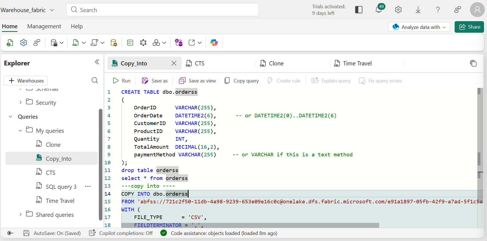
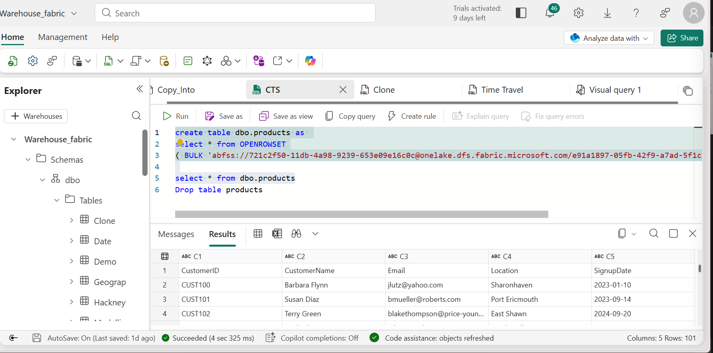
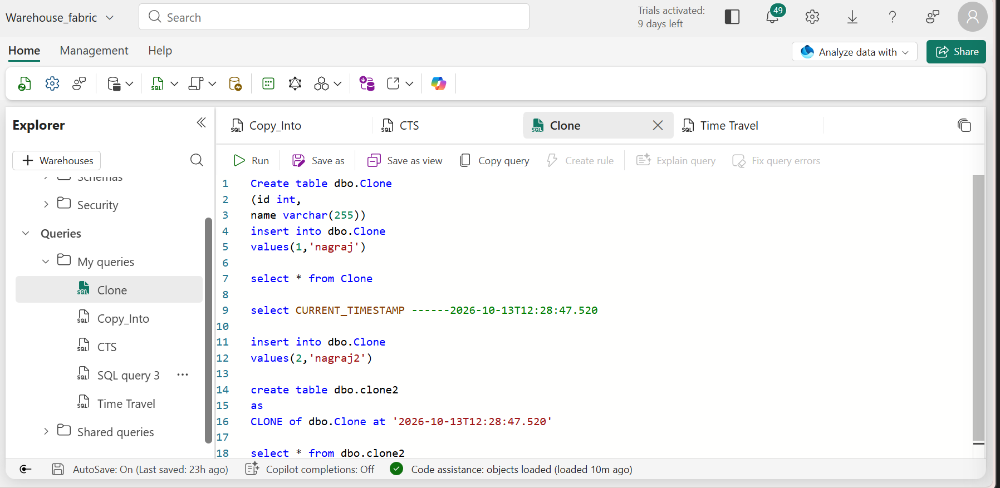

# Fabric-Warehouse

# What I Learned About Warehouses in Microsoft Fabric

## 📌 Introduction

As part of my Microsoft Fabric learning journey, I explored how a Fabric Warehouse works, how it differs from a Lakehouse, and how SQL-based operations can be used to load, transform, query, and manage analytical data.

I also learned about important Warehouse features and concepts, including `OPENROWSET`, `COPY INTO`, CTAS, table cloning, version history, and the Visual Query Editor.

This learning helped me understand how Microsoft Fabric supports data warehousing and how these capabilities can be used to prepare reliable, structured data for Power BI reporting.

## 🏗️ 1. Understanding Lakehouse vs. Warehouse

Microsoft Fabric provides both Lakehouse and Warehouse experiences. Although they can work together in an analytics solution, they have different storage and processing approaches.

### Lakehouse

* Stores data in OneLake, commonly using Delta Lake tables backed by Parquet files.
* Supports data engineering workloads using Spark, Python, and other supported tools.
* Provides flexibility for structured and semi-structured data processing.
* Uses the Delta transaction log to track changes and support reliable table operations.

### Warehouse

* Provides a fully managed relational data warehousing experience.
* Supports T-SQL for querying, transforming, and managing analytical data.
* Is designed for structured, relational data and SQL-based analytics.
* Integrates with Power BI and other Microsoft Fabric analytics experiences.

### My Key Learning

A Fabric Lakehouse and a Fabric Warehouse are not the same thing. A Lakehouse commonly uses open file formats and Delta tables in OneLake, while a Fabric Warehouse provides a managed relational data warehousing experience.

Understanding the differences helps me choose the appropriate Fabric experience for a particular data engineering or analytics requirement.

## 🔄 2. Understanding Delta Lake and Parquet

Delta Lake builds on the Parquet file format by adding a transaction log that records changes to a table.

### Important Concepts

**Parquet**

Parquet is a columnar file format designed for efficient data storage and analytical workloads.

**Delta Lake**

Delta Lake adds transactional capabilities and table-management functionality on top of data files.

**Delta Transaction Log**

The transaction log records table changes and versions, helping support ACID transactions and consistent data operations.

**Delta Tables**

Delta tables provide a structured table interface over underlying data files and transaction history.

### My Key Learning

Delta tables are more than individual Parquet files. The transaction log helps track changes and maintain consistency.

However, these Delta Lake storage concepts should not be assumed to describe the internal storage architecture of Fabric Warehouse, which is a separate managed data warehousing experience.

## 🧰 3. OPENROWSET

`OPENROWSET` can be used in supported SQL scenarios to query external data without first loading it into a permanent table.

### What I Learned

* Read supported external data sources using SQL.
* Explore file-based data before loading it into warehouse tables.
* Inspect data and validate its structure.
* Understand the difference between querying external data and storing it in a managed table.

### Example Use Case

Suppose sales data is available in a supported Parquet file. An external-data query can help inspect the file before deciding how to load and transform the data.

The exact syntax, supported file formats, and accessible locations depend on the Fabric SQL experience being used.

## 📥 4. COPY INTO

`COPY INTO` is used to load data from supported external storage into an existing Fabric Warehouse table.

### What I Learned

* Load data from supported external file sources.
* Use SQL-based ingestion for analytical workloads.
* Understand how external data becomes available in warehouse tables.
* Prepare datasets for further SQL transformations and Power BI reporting.

### Example Use Case

Suppose daily sales records are available in supported external storage. A `COPY INTO` operation can load the records into a destination table such as `dbo.Sales`.

This is useful when building data ingestion workflows that move source data into a warehouse for analytical processing.

## 🖼️ COPY INTO Screenshot



## 🏗️ 5. CTAS — CREATE TABLE AS SELECT

CTAS stands for **CREATE TABLE AS SELECT**. It creates a new table from the results of a query.

### What I Learned

* Create a table from an existing query result.
* Filter and transform data while creating a new table.
* Prepare curated datasets for analytical reporting.
* Reduce the need for separate table-creation and data-insertion steps in supported scenarios.

### Example

The following illustrates the concept of creating a table containing high-value orders. Confirm the exact CTAS syntax supported by your Fabric Warehouse environment before running it.

```sql
CREATE TABLE dbo.HighValueOrders
AS
SELECT *
FROM dbo.Orders
WHERE OrderAmount > 1000;
```

### Example Use Case

A business may need a separate dataset containing only orders above a specified amount. CTAS can create a new table from the filtered results, making the data available for further analysis.

## 🖼️ CTAS Screenshot



## 🧬 6. Table Cloning

I explored table cloning and how creating a separate copy of data can help with development, testing, and experimentation.

### What I Learned

* Understand why a separate copy of data may be useful.
* Explore ways to test transformations without directly modifying the original dataset.
* Recognize the differences between copying data and cloning a table.
* Understand that cloning capabilities depend on the specific Fabric workload and supported object type.

### Example Use Case

A developer may want to test a transformation on a separate dataset before applying the changes to production data.

A supported cloning or copying approach can help separate experimentation from the original data.

**Important:** Do not assume that a `CLONE` statement available in another SQL engine or Delta Lake environment is supported in Fabric Warehouse. Confirm the exact feature and syntax for the workload you are using.

## 🖼️ Table Cloning Screenshot



## 🕒 7. Version History and Time Travel Concepts

I explored version history and the concept of accessing earlier versions or states of data.

### What I Learned

* Understand how table changes and versions can be tracked.
* Recognize the importance of historical information for auditing and troubleshooting.
* Explore how historical data can help investigate unexpected changes.
* Understand that historical access and recovery capabilities depend on the specific storage engine and Fabric feature.

### Example Use Case

Suppose a transformation changes the results of an analytical dataset unexpectedly. Historical information, where supported, may help investigate what changed and identify the cause.

**Important:** Delta Lake time travel and Fabric Warehouse version history are not interchangeable features. Always confirm which historical access, retention, and recovery capabilities are available for the specific Fabric object.

## 🖼️ Version History Screenshot


## 🖱️ 8. Visual Query Editor

I explored the Visual Query Editor in Microsoft Fabric, which provides a graphical interface for building queries and performing supported data operations.

### What I Learned

* Build queries through a visual interface.
* Explore and combine tables.
* Apply supported filtering and joining operations.
* Understand how visual query building can complement manually written SQL.
* Use graphical tools to explore data and understand transformation logic.

### Example Use Case

Suppose a sales report needs information from sales and customer tables. A visual query workflow can help combine the tables and select the required columns before the resulting data is used for analysis.

The available operations depend on the specific visual query experience and connected data source.

## 🖼️ Visual Query Editor Screenshot


## 📊 9. How These Concepts Fit Together

The features I explored can support different stages of an analytical data workflow.

1. **Explore external data:** Use supported `OPENROWSET` scenarios to inspect external files.
2. **Load data:** Use `COPY INTO` to load supported external data into a Warehouse table.
3. **Transform data:** Use SQL queries and CTAS to create curated analytical tables.
4. **Test changes:** Use an appropriate supported copying or cloning approach.
5. **Investigate changes:** Explore available history and recovery capabilities for the relevant Fabric object.
6. **Build queries:** Use the Visual Query Editor or write SQL directly.
7. **Report:** Connect curated data to Power BI for analysis and visualization.

## 🎯 10. Key Takeaways

Through this learning exercise, I gained a better understanding of:

* The differences between Microsoft Fabric Lakehouse and Warehouse.
* The relationship between Parquet, Delta Lake, and the Delta transaction log.
* Querying supported external data with `OPENROWSET`.
* Loading supported data sources using `COPY INTO`.
* Creating tables from query results using CTAS.
* Understanding table cloning and its potential uses in development and testing.
* Learning about version history and historical data-access concepts.
* Building queries using the Visual Query Editor.
* Preparing structured and curated data for analytical reporting.
* Recognizing that supported SQL syntax and features can differ between Fabric workloads.

## 🚀 11. Next Steps

My next step is to practise these concepts using sample datasets in Microsoft Fabric.

I plan to:

* Create and query Warehouse tables.
* Practise SQL joins, aggregations, and window functions.
* Load sample data and perform transformations.
* Explore supported external-data operations and table-creation methods.
* Connect the resulting analytical data to Power BI.
* Document my queries, results, and implementation screenshots in GitHub.

This practical approach will help me strengthen my SQL, data warehousing, and Microsoft Fabric Analytics Engineering skills.

## 👨‍💻 Conclusion

Learning about Microsoft Fabric Warehouse has helped me understand how structured data can be managed and prepared for analytics.

By combining SQL, data loading, transformations, data modeling, and Power BI integration, I am building a stronger foundation for developing end-to-end analytics solutions with Microsoft Fabric.
